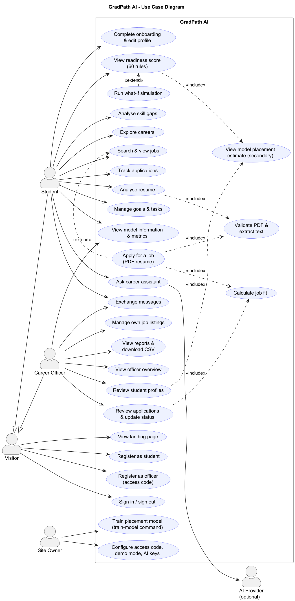
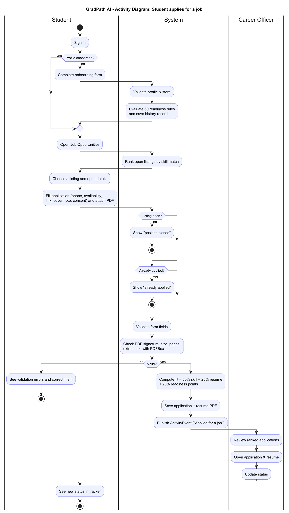
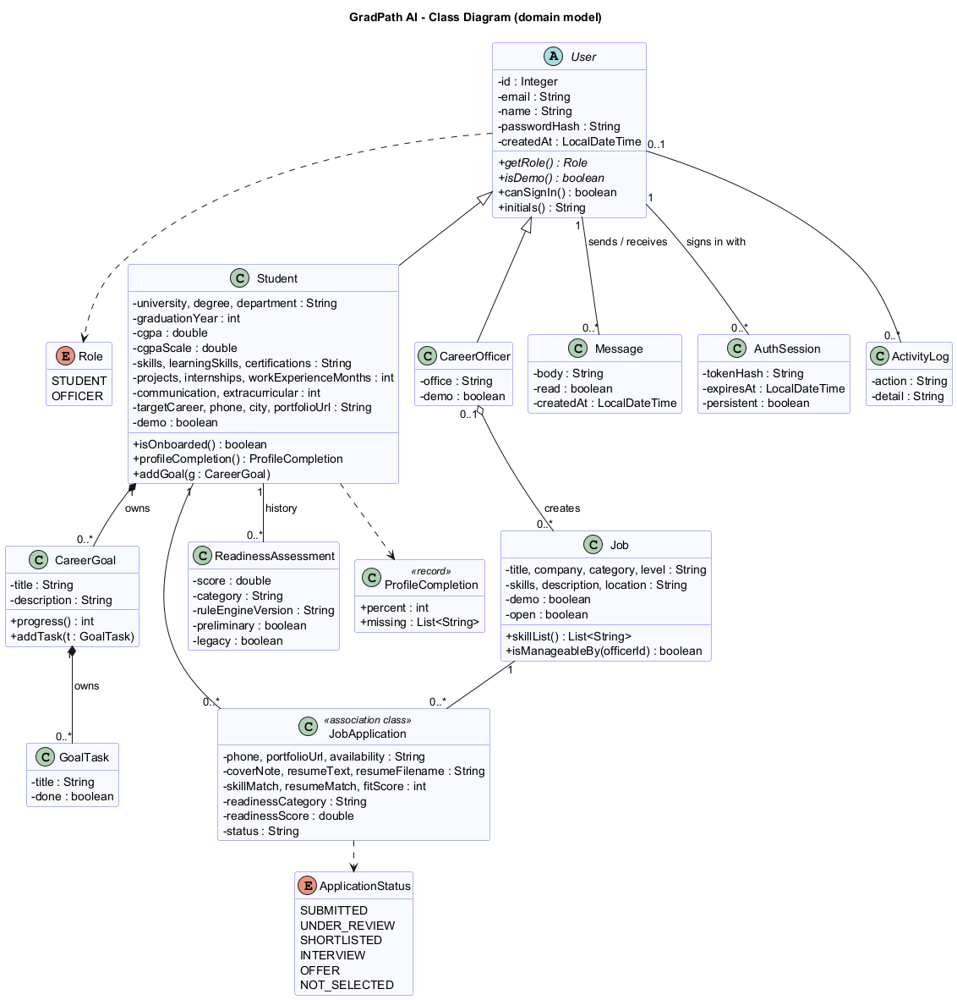
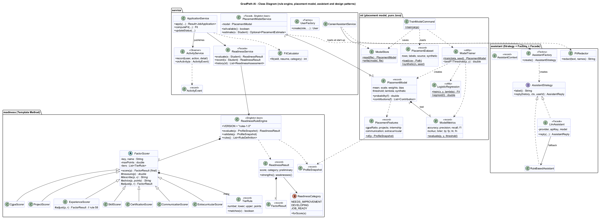
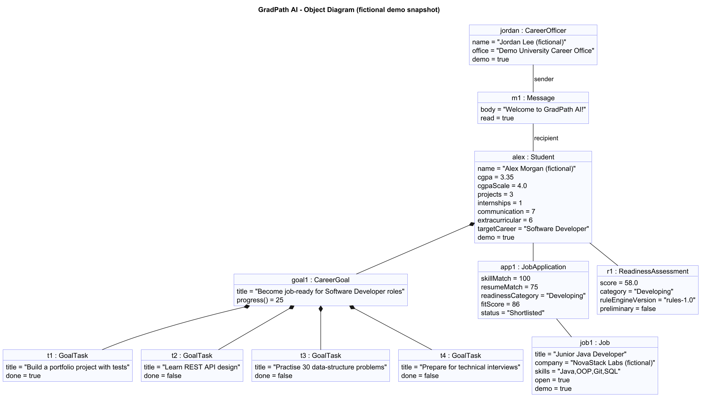
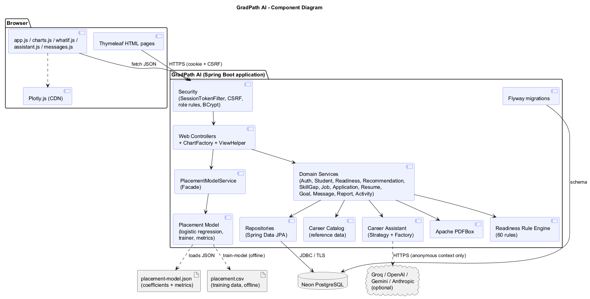
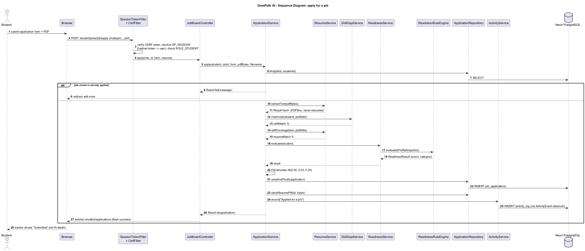
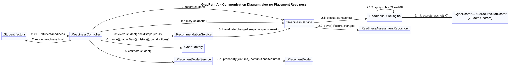
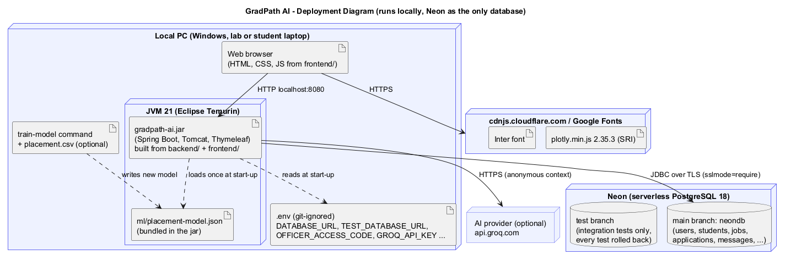

# GradPath AI - Graduate Career Placement Prediction System

**CT-263 Object-Oriented Analysis & Design - Complex Computing Problem (CCP) Report**

Group members: Amna Mohsin, Hamna Ali Khan  
Technology: Java 21, Spring Boot 3.4, Thymeleaf, Neon PostgreSQL, Flyway, Apache PDFBox, Plotly.js, JUnit 5

> Note for the group: replace the screenshot placeholders in Section 5 with screenshots taken from the running system
> during your lab demonstration. All diagrams in Section 4 are generated from `report/uml/*.puml` and match the code in
> `backend/src/main/java` exactly.

---

## 1. Introduction

Many university graduates struggle to judge how ready they are for the job market. Advice is spread across course
advisors, job portals and peers, and the Career Office rarely has an up-to-date, structured view of each student's
academic record, skills and experience. As a result, students apply late or to unsuitable roles, and career officers
spend time on manual screening instead of guidance.

**GradPath AI** is a web-based career-readiness platform that connects students with their university Career Office.
Students maintain a profile, receive a transparent readiness score, discover skill gaps for example career paths,
search and apply for jobs, analyse their resumes, track goals and message career officers. Career officers review
student profiles and applications (ranked by an explainable job-fit score), manage job listings and view analytics.

The system is designed as an **educational decision-support tool**. Its readiness score is calculated by
**60 documented, deterministic rules**, so every point can be explained to the student. Alongside it, a
**logistic-regression placement model**, implemented and trained entirely in Java, gives a clearly labelled
*secondary* estimate of the chance of placement with a per-feature explanation. The rule score stays the official
measure. Both are guidance only - not guarantees of placement, hiring decisions or measures of worth.

## 2. Objectives

1. Model the career-placement domain with object-oriented analysis and design: classes, objects, inheritance,
   aggregation, composition and association.
2. Provide students with an explainable readiness score (0-100) from 60 deterministic rules, with factor breakdowns,
   strengths, weaknesses, next steps, score history and a what-if simulator.
3. Support the full student journey: registration, onboarding, skill-gap analysis, career exploration, job search,
   applications with PDF resumes, resume analysis, goals and messaging.
4. Support Career Officers: student review, application ranking and status workflow, job management with ownership
   rules, messaging and privacy-preserving reports.
5. Apply recognised design patterns (Template Method, Strategy, Factory, Facade, Observer, Repository, Singleton).
6. Store data securely in a hosted PostgreSQL database (Neon) with versioned migrations, and protect accounts with
   BCrypt passwords, revocable sessions, CSRF protection and role-based authorisation.
7. Verify correctness with automated JUnit tests and document the design with eight kinds of UML diagram.
8. Implement a data-driven placement model without external ML libraries: load a placement CSV, train an
   L2-regularised logistic regression with cross-validation, evaluate it on held-out data (ROC-AUC, accuracy,
   precision, recall, F1, calibration) and explain each individual estimate.

## 3. Problem Statement

Students lack a transparent, personalised and actionable view of their employability, and Career Offices lack a
shared system to review students, publish opportunities and prioritise applications fairly.

The system must therefore:

* turn a student's profile (CGPA, projects, internships/experience, technical skills, certifications, communication
  and extracurricular activity) into an **explainable** readiness score with clear next steps, without using sensitive
  demographic data;
* compare skills against illustrative career requirements and job listings;
* let students apply to jobs with validated PDF resumes, and let officers review applications ranked by a transparent
  fit score while keeping the final decision with a person;
* keep each user's data private (role-based access, ownership checks, no contact details in exports);
* never present demonstration data as real people or real vacancies;
* learn from historical placement data where it is available, while reporting the model's accuracy and limits
  honestly and never letting it override the explainable rule score.

## 4. Methodology

### 4.1 Process and architecture

The project followed an iterative OOAD process: requirements were captured as use cases (4.3), workflows as activity
diagrams (4.4), the static structure as class and object diagrams (4.5-4.6), the runtime collaboration as sequence and
communication diagrams (4.8-4.9) and the physical structure as component and deployment diagrams (4.7, 4.10).

The implementation is a layered Spring Boot web application:

| Layer | Package | Responsibility |
|---|---|---|
| Presentation | `web` (backend), `frontend/templates`, `frontend/static` | Thin Spring MVC controllers, Thymeleaf pages, Plotly chart specifications |
| Security | `security`, `config.SecurityConfig` | Session-cookie authentication, CSRF, role rules, BCrypt, login throttling |
| Business logic | `service`, `service.assistant` | Profiles, readiness history, recommendations, jobs, applications, resumes, goals, messages, reports, assistant |
| Rule engine | `readiness` | The 60 readiness rules |
| Reference data | `reference` | Illustrative careers, skill aliases, learning tips |
| Persistence | `repository`, `domain`, `db/migration` | JPA entities, Spring Data repositories, Flyway migrations on Neon PostgreSQL |

### 4.2 Object-oriented concepts used

| Concept | Implementation |
|---|---|
| Class & object | Entities such as `Student`, `Job`, `JobApplication`; value objects (Java records) such as `ProfileSnapshot`, `ReadinessResult` |
| Encapsulation | Private fields with intention-revealing methods: `Student.isOnboarded()`, `CareerGoal.progress()`, `Job.isManageableBy()` |
| Inheritance | `User` (abstract) is specialised by `Student` and `CareerOfficer` (JPA joined-table inheritance); `FactorScorer` (abstract) by seven scorers |
| Polymorphism | `User.getRole()` / `isDemo()`; `FactorScorer.measure()` / `describe()` / `adjust()`; `AssistantStrategy.reply()` |
| Abstraction / interfaces | `AssistantStrategy`, `HttpTransport`, `BaseRepository<T>` |
| Composition | `Student` ◆— `CareerGoal` ◆— `GoalTask` (cascade delete, orphan removal); `ReadinessRuleEngine` ◆— 7 `FactorScorer`s |
| Aggregation | `CareerOfficer` ◇— `Job` (listings survive if the officer is removed: `ON DELETE SET NULL`) |
| Association (class) | `JobApplication` links `Student` and `Job` and carries its own attributes |

### 4.3 Design patterns

| Pattern | Classes | Why |
|---|---|---|
| **Template Method** | `FactorScorer.score()` (final) calls `measure()`, `describe()`, `advice()` and the hook `adjust()`; `ExperienceScorer` overrides `adjust()` for rule 58 | The tier-rule algorithm is written once; each factor only supplies its measurement and wording |
| **Strategy** | `AssistantStrategy` ← `RuleBasedAssistant`, `LlmAssistant` | The career assistant can switch between the built-in rules and an AI provider without changing callers |
| **Factory** | `UserFactory` (role → `Student`/`CareerOfficer`), `AssistantFactory` (configuration → strategy) | Object creation decisions in one place |
| **Facade** | `ReadinessService` (engine + history), `PlacementModelService` (model file + features + explanation), `LlmAssistant` (Groq/OpenAI/Gemini/Anthropic APIs behind `reply()`) | Simple interfaces over complex subsystems |
| **Observer** | Services publish `ActivityEvent`; `ActivityService.onActivity()` listens and stores it | Activity logging is decoupled from the operations that trigger it |
| **Repository** | `BaseRepository<T>` and specific repositories | Persistence hidden behind collection-like interfaces |
| **Singleton** | Spring beans (`ReadinessRuleEngine`, `PlacementModelService` - model loaded once, connection pool) | One shared, stateless instance per application |

### 4.4 Use case diagram

Actors: Visitor (generalises Student and Career Officer), Site Owner (configuration) and an optional external AI
Provider. «include» shows mandatory sub-behaviour (PDF validation, fit calculation); «extend» shows optional behaviour
(what-if simulation, applying from the job list).

### 4.5 Activity diagram - applying for a job

Swim-lanes separate the Student, the System and the Career Officer. Decisions cover onboarding, closed listings,
duplicate applications and validation failures.

### 4.6 Class diagrams

**Domain model**

**Rule engine, placement model, assistant and design patterns**

### 4.7 Object diagram

A run-time snapshot of the fictional demo data: student *Alex Morgan* owns a goal with two tasks (25% progress), has
one readiness record (58, Developing) and one application to a demo listing with fit 86 = 0.55×100 + 0.25×75 + 0.20×60.

### 4.8 Component diagram

### 4.9 Sequence diagram - applying for a job

### 4.10 Communication diagram - viewing Placement Readiness

### 4.11 Deployment diagram

### 4.12 The 60-rule readiness engine

| Factor | Max points | Rules |
|---|---|---|
| CGPA (ratio to the student's scale) | 30 | 1-9 (below 0.50 → 0 ... exactly 1.00 → 30) |
| Completed projects | 20 | 10-16 (0 → 0 ... 7+ → 20) |
| Internships / experience | 15 | 17-22 (0 → 0 ... 5+ → 15) |
| Technical skills (confident + ½ learning) | 15 | 23-31 (below 0.5 → 0 ... 8+ → 15) |
| Certifications | 5 | 32-36 |
| Communication rating | 10 | 37-46 |
| Extracurricular rating | 5 | 47-57 |
| Decision rules | - | 58 work experience ≥ 12 months substitutes for a missing internship (≥ 5 points, no stacking); 59 completion < 50% → Preliminary + missing items; 60 categories: < 40 Needs Improvement, 40-69.9 Developing, ≥ 70 Job Ready |

Exactly one tier rule applies per factor; invalid input (negative counts, CGPA above the scale, ratings outside 0-10)
raises a validation error instead of a silent fallback. The **job-fit** score used to rank applications is
55% skill match + 25% resume keyword match + 20% readiness category points (100 / 60 / 25).

### 4.13 The placement model (secondary estimate)

The `ai.gradpath.ml` package implements supervised learning in plain Java, with no ML library and no Python:

| Step | Implementation |
|---|---|
| Data | `PlacementDataset.load()` reads a placement CSV (Kaggle-style column aliases, CGPA scale detected). Only five features are read - CGPA ratio, projects, internship (yes/no), communication, extracurricular - so sensitive columns such as IQ are ignored. |
| Split | Stratified 80% training / 20% test with a fixed seed (`ModelTrainer`). |
| Algorithm | `LogisticRegression`: L2-regularised logistic regression fitted with Newton's method (IRLS), solving a 6x6 system per step - deterministic and fast. |
| Tuning | Stratified 5-fold cross-validation over penalties 0-1000; standardisation fitted inside each fold to avoid leakage; best mean ROC-AUC chosen. |
| Threshold | The probability that maximises F1 on out-of-fold predictions. |
| Evaluation | `ModelMetrics`: ROC-AUC (Mann-Whitney rank formula), accuracy, precision, recall, F1, Brier score, log loss, confusion matrix, ROC and calibration curves - on the untouched test rows. |
| Storage | `ModelStore` writes `placement-model.json` (coefficients and metrics only). `PlacementModelService` loads it once and returns a `PlacementEstimate` with per-feature log-odds contributions. |

Training runs from the same jar: `java -jar gradpath-ai.jar train-model placement.csv`. Inputs outside the training
range are clamped and flagged. The estimate appears on Placement Readiness, in the what-if simulator and on the
officer's student review page, and an **About the Model** page shows the metrics and charts.

### 4.14 Data and security design

* **Database:** Neon PostgreSQL is the only database; the application runs locally and connects to Neon over TLS.
  Integration tests use a separate Neon *test branch*, and every test is rolled back. Flyway migration V1 matches the earlier schema (so the existing database is
  baselined), V2 adds columns, indexes, foreign keys and check constraints without deleting data. Unique email,
  unique (job, student) application, cascading goal/task deletion.
* **Security:** BCrypt password hashes (legacy hashes upgraded on sign-in), generic sign-in errors and throttling,
  random session tokens stored only as SHA-256 hashes in revocable `auth_sessions` rows, `HttpOnly`/`SameSite` cookies,
  CSRF tokens, Content-Security-Policy, role checks on routes and service methods, ownership checks, PDF validation,
  and CSV exports without contact details.
* **Privacy:** no sensitive demographic data; the AI assistant receives only anonymous numbers and redacted text.

## 5. Results

### 5.1 Implemented system

All student pages (Overview, My Profile, Placement Readiness, Skill-Gap Analysis, Career Explorer, Job Opportunities,
Applications, Resume Analyzer, Career Goals, Messages, Career Assistant) and officer pages (Overview, Students,
Applications, Job Management, Reports & Analytics, Messages, Profile) are implemented end to end, plus the public
landing page, registration, onboarding, "How the Score Works" and "About the Model".

Screenshots to insert (take them from the running system):

| # | Screen | Placeholder |
|---|---|---|
| 1 | Landing page with sign-in / registration | *(insert screenshot)* |
| 2 | Student overview dashboard | *(insert screenshot)* |
| 3 | Placement Readiness: gauge, factor table with rule numbers | *(insert screenshot)* |
| 4 | Placement Readiness: biggest levers and what-if simulator | *(insert screenshot)* |
| 5 | Skill-gap analysis | *(insert screenshot)* |
| 6 | Job opportunities ranked by skill match / application form | *(insert screenshot)* |
| 7 | Resume analyzer results | *(insert screenshot)* |
| 8 | Career goals with progress | *(insert screenshot)* |
| 9 | Messages | *(insert screenshot)* |
| 10 | Career assistant | *(insert screenshot)* |
| 11 | Officer overview with charts | *(insert screenshot)* |
| 12 | Ranked applications and application review | *(insert screenshot)* |
| 13 | Job management | *(insert screenshot)* |
| 14 | Reports & analytics | *(insert screenshot)* |
| 15 | Placement Readiness: secondary model estimate with feature effects | *(insert screenshot)* |
| 16 | About the Model: metrics, ROC and calibration charts | *(insert screenshot)* |

### 5.2 Example outputs

| Profile (4.0 scale) | Factor points (CGPA, projects, experience, skills, certs, communication, extracurricular) | Score | Category |
|---|---|---|---|
| CGPA 2.8, 2 projects, 1 internship, 3 skills, 1 cert, comm 5, extra 4 | 12 + 8 + 5 + 6 + 1 + 5 + 2 | 39 | Needs Improvement |
| CGPA 3.2, 3 projects, 1 internship, 4 skills, 1 cert, comm 7, extra 6 | 16 + 12 + 5 + 8 + 1 + 7 + 3 | 52 | Developing |
| CGPA 3.6, 4 projects, 2 internships, 6 skills, 2 certs, comm 8, extra 8 | 24 + 16 + 9 + 12 + 3 + 8 + 4 | 76 | Job Ready |
| No internship, 14 months work experience | experience factor = 5 (rules 17 + 58) | - | - |

**Placement model.** The bundled model was trained on 10,000 rows of *synthetic practice data* (seed 42), because
the Kaggle CSV is not distributed with the code; the UI labels it "Practice model". Re-running `train-model` on a
licensed `placement.csv` replaces these numbers with real-data results.

| Measure | Value |
|---|---|
| Training / test rows | 7,999 / 2,001 (stratified) |
| Cross-validated ROC-AUC (5 folds) | 0.779 ± 0.012 (chosen L2 penalty 1000; all penalties within 0.001) |
| Test ROC-AUC | 0.797 |
| Test accuracy / precision / recall / F1 | 0.717 / 0.697 / 0.906 / 0.788 (threshold 0.47) |
| Test Brier score | 0.191 |
| Odds ratio per standard deviation | CGPA 1.60, communication 1.36, internship 1.28, projects 1.28, extracurricular 1.11 |

All five effects are positive and CGPA has the largest, which matches the relationship built into the practice data
and the weighting of the rule engine.

### 5.3 Test results

`./mvnw test` - **190 tests, 0 failures, 0 errors**. The database tests run on a separate Neon test branch
(`TEST_DATABASE_URL`), never on the live data, and each one is rolled back.

| Test class | Focus |
|---|---|
| `ReadinessRuleEngineTest` | 60 rules exist and are numbered 1-60; contiguous tiers; every tier boundary of all seven factors; rules 58, 59, 60; minimum (0) and maximum (100) scores; all three categories; determinism; validation errors |
| `UnitServicesTest` | Input validators; BCrypt and legacy PBKDF2 verification; login throttle; job skill match (learning = half); career skill-gap weighting; fit formula and label boundaries; PDF extraction and analysis; non-PDF/unreadable files; keyword matching; built-in assistant determinism; PII redaction; AI fallback; `.env` parsing; CSV injection protection |
| `AuthServiceIT` | Registration validation, normalisation, duplicates, officer access code, generic errors, lock-out, legacy hash upgrade, session revocation |
| `DomainServicesIT` | Applications (fit, activity event, duplicates, closed jobs, validation, statuses, resume access), job ownership and read-only demo listings, goal progress and ownership, messaging rules and read status, profile validation, readiness history |
| `WebSecurityIT` | Public vs protected routes, role separation, all pages render for both roles, CSRF, cookie flags, logout revocation, onboarding gate, what-if not saved, CSV without personal data |
| `PlacementModelTest` | Sigmoid stability; linear solver; Newton recovers known coefficients; L2 shrinkage; ROC-AUC and confusion matrix by hand; F1 threshold; stratified split; deterministic training that beats chance; expected effect directions; clamping; contributions sum to the logit; JSON round trip and format checks; bundled model loads; CSV aliases, skipped rows, missing columns, quoting |
| `MigrationIT` | Flyway V1 and V2 applied, new columns present, database check constraints |

The application was also smoke-tested against the live Neon database: the existing schema was baselined, the V2
migration applied successfully, and all pre-existing records (users, students, jobs, applications, messages, goals)
were preserved.

## 6. Conclusion

GradPath AI demonstrates how object-oriented analysis and design produce a maintainable, explainable system. The
domain model uses inheritance (`User` → `Student`/`CareerOfficer`), composition (`Student` → goals → tasks),
aggregation (`CareerOfficer` → `Job`) and an association class (`JobApplication`). The readiness engine shows the
Template Method pattern turning 60 business rules into seven small, testable classes, while Strategy, Factory, Facade,
Observer, Repository and Singleton keep the assistant, services and persistence flexible and loosely coupled.

Keeping deterministic rules as the official score made every result explainable and fully testable: each tier
boundary is covered by an automated test. The Java logistic-regression model complements it with a data-driven view,
evaluated honestly on held-out data and explained feature by feature, without ever overriding the rules. Security and privacy were treated as design requirements (hashed passwords,
revocable sessions, CSRF, role and ownership checks, no sensitive data in scoring or exports).

**Learning outcomes:** translating requirements into use cases and UML models; keeping the code and diagrams
consistent; applying design patterns where they simplify change; designing a relational schema with safe, versioned
migrations; and verifying behaviour with unit and integration tests.

**Limitations and future work:** the bundled model is trained on synthetic practice data until a licensed real
dataset is supplied, and it sees only five features; career requirements are illustrative, resume analysis is keyword-based, and the
authentication is not a substitute for an institutional identity provider. Future work could add institution SSO,
employer accounts, interview scheduling and accessibility auditing with real users.
